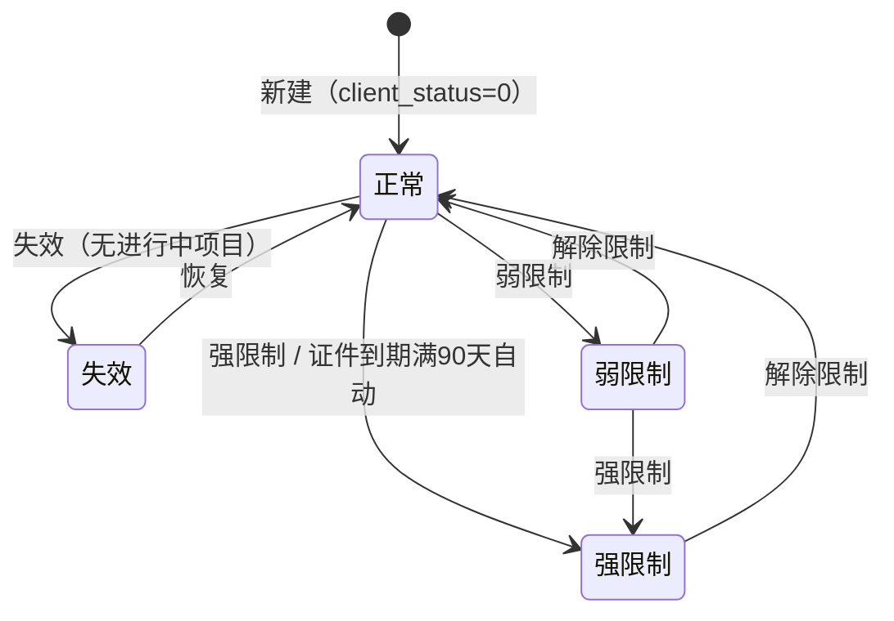
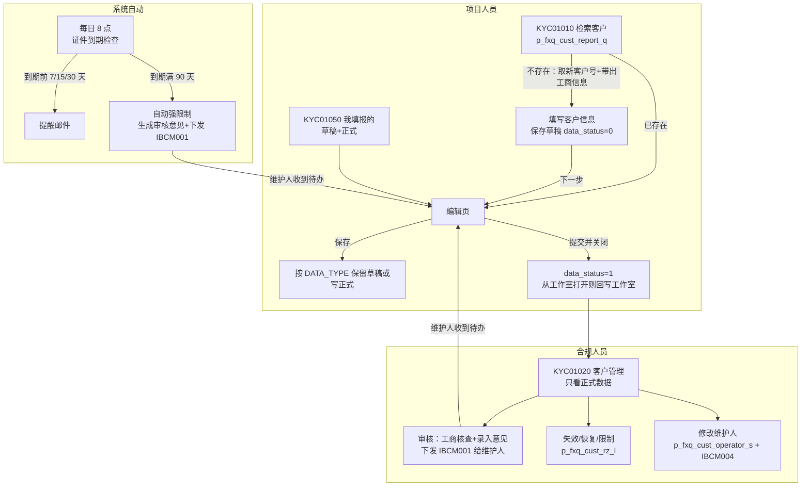

# 反洗钱系统（融资端客户 KYC）需求说明书

> **依据**：`v10/反洗钱` 页面代码、工作区 `存储过程/` 下 6 个存储过程源码、Java 后端 `ibcm-flow-proc`、交接文档。配套文档：《存储过程流程解析》《反洗钱数据表说明》。
>
> **范围**：菜单中可见的 6 个页面（KYC01010、KYC01020、KYC01050、KYC01060、KYC01070、KYC01080），以及不在菜单里但影响业务的部分：全链接审核表单、每日定时任务。`KYC01030 客户填报人维护`、`KYC01040 客户填报人查询` 在菜单中隐藏（`hideInMenu: true`），KYC01030 的接口被“修改维护人”复用。
>
> **阅读约定**：正文描述系统**当前实际行为**；与预期不符的地方用 **【问题 Pxx】** 标出，详见第 13 章；需要业务拍板的用 **【待确认 Qxx】** 标出，详见第 14 章。

---

## 1. 概述

### 1.1 背景与目标

系统为投行业务的融资端客户建立反洗钱尽职调查（KYC）档案，覆盖以下环节：

- 客户识别：检索、新增（机构客户自动带出工商信息）
- 身份信息与关联人登记：法定代表人、控股股东、实际控制人、授权代表人、受益所有人
- 特殊情况申报、附件底稿管理
- 合规审核：工商核查、录入审核意见、下发整改待办
- 客户状态管控：失效、恢复、强限制、弱限制、解除限制
- 维护人变更
- 自动管控：证件到期提醒、到期满 90 天自动强限制并下发审核意见

对接的外部服务：企查查（工商信息、受益所有人）、全链接工作流（待办流程）、投行工作室（项目状态回写、项目查询）、BOMIS（受益所有人实时核验）、统一消息平台（邮件）。

### 1.2 功能入口清单

| 编号 / 入口 | 名称 | 主要使用者 | 定位 |
|---|---|---|---|
| KYC01010 | 反洗钱客户填报 | 项目组填报人 | 客户检索与新增入口 |
| KYC01020 | 反洗钱客户管理 | 合规人员 | 全量正式客户的管理、审核、状态管控、维护人变更 |
| KYC01050 | 我填报的反洗钱客户 | 项目组填报人 | 个人名下客户（含草稿）的维护 |
| KYC01060 | 国家或地区维护 | 系统管理员 | 字典维护 |
| KYC01070 | 受益所有人类型维护 | 系统管理员 | 字典维护 |
| KYC01080 | 反洗钱客户审核类型设置 | 系统管理员 | 审核错误类型维护 |
| 全链接表单 | IBCM001 反洗钱客户审核表单 | 合规人员、维护人 | React 前端 `ibcm-flow-ui-pro` + Java 后端，承载审核提交和整改待办 |
| 定时任务 | 证件到期提醒、到期强限制 | 系统 | 见第 10 章 |

### 1.3 角色与权限

| 角色 | 标识 | 权限 |
|---|---|---|
| 反洗钱填报人 | 角色 `fxqtb-th` | 填报客户；只有该角色的人能被选为“维护人”。【待确认 Q04：交接文档写作 `th-fxqtb`】 |
| 风险核查查看人 | 角色 `fxqrisk-th` | 看到风险等级、风险名单筛查结果，以及客户详情的“反馈结果”页签 |
| 测试数据查看人 | 用户 `admin`、`huangzhichang` | 能看到 `cust_biz = '测试'` 的客户（`admin` 创建的客户自动标为测试） |
| 管理员 | 用户 `admin` | KYC01050 中看到全部客户 |

填报权限的现状：`p_fxq_cust_report_q` 会查当前用户是否有填报角色（`fxq_cust_wh`、`fxqtb-th`、`fxqgl`），但拦截代码已注释，**任何登录用户都能填报**；前端“当前用户无反洗钱客户填报权限，请联系合规管理员！”的提示实际不会出现。【问题 P05】

按钮级权限：KYC01020 的操作按钮通过 `bindModule` 绑定模块权限。

### 1.4 核心状态

三个状态字段都在客户主表 `t_th_client_info`：

| 字段 | 含义 | 取值 | 谁改它 |
|---|---|---|---|
| `data_status` | 数据状态 | `0` 草稿、`1` 正式 | 保存草稿写 0；提交写 1；编辑页“保存”按入参 `DATA_TYPE` 写 |
| `client_status` | 客户状态 | `0` 正常、`1` 失效、`2` 强限制、`3` 弱限制 | 只由 `p_fxq_cust_rz_l` 和定时任务修改；保存/提交不会改 |
| `work_type` | 最近一次操作类型 | `0` 创建、`1` 更新 | 新增页保存写 0；编辑页保存/提交写 1。【问题 P21：注释里还出现过“2 确认”，代码未使用】 |

要点：

- **草稿也存在正式表里**，靠 `data_status = '0'` 区分。草稿表 `t_th_client_info_draft` 只是 5 月上线时迁移的老系统草稿（933 条），之后无人写入，但仍被部分查询读取。【问题 P13】
- 合规列表只显示 `data_status = '1'`；“我填报的”草稿和正式都显示。
- 提交（草稿变正式）**不会给合规发待办**，合规需要在 KYC01020 主动查看审核。【待确认 Q01】

客户状态流转：

### 1.5 公共字典

| 字段 | 取值 |
|---|---|
| 客户类型 `organ_flag` | 0 自然人、1 机构（新增后不可修改） |
| 客户归属 `client_belong` | 1 融资端、2 投资端（新增只能选融资端；保存时不更新） |
| 业务分类 `cust_biz` | 投行、测试（创建人为 `admin` 时为测试） |
| 关联人类型 `related_type` | 1 法定代表人、2 控股股东、3 实际控制人、4 授权代表人、5 受益所有人 |
| 状态变更操作标识 `OP_FLAG` | 0 正常（恢复/解除限制）、1 失效、2 强限制、3 弱限制 |

### 1.6 公共交互规范

- 列表页统一提供“查询”“重置”按钮，按回车等同于点“查询”；“重置”应清空全部条件并重新查询。【问题 P19、P20】
- 分页每页 100 条，支持列排序和文本选中。
- 需要选中数据的操作，没选时提示“请选中 1 条数据”。
- 删除、失效、限制等破坏性操作都要二次确认。
- 状态类操作在前端先做状态前置校验（见 8.2），后端存储过程不重复校验。

---

## 2. 端到端业务流程

**项目人员**：检索客户 → 新客户先保存草稿 → 进入编辑页完善关联人、特殊情况、附件 → 提交。之后在 KYC01050 持续维护；收到审核待办后修改并再次提交。

**合规人员**：在 KYC01020 查看已提交的客户 → 审核（工商核查、录入问题）→ 系统给维护人下发整改待办；按需对客户做失效、限制、维护人变更。

**系统自动**：每天检查客户本人、法定代表人、受益所有人的证件有效期，到期前发提醒邮件；到期满 90 天仍未更新的客户自动强限制，并下发审核意见待办。

---

## 3. KYC01010 反洗钱客户填报

### 3.1 功能描述

填报入口：先检索客户是否已经存在，存在则进入编辑，不存在则新增。

### 3.2 检索区

- 左侧下拉选客户类型：机构（默认）或自然人。
- 中间是带联想下拉的输入框，右侧是搜索按钮。
- 切换类型时，提示文案和占位符跟着变：
  - 机构：请输入完整的【公司名称】或【统一社会信用代码】，括号用【全角】，点搜索做模糊匹配。
  - 自然人：请输入完整的【客户姓名】，括号用【全角】。
- 输入为空时提示“请输入检索内容”。

### 3.3 机构检索流程

1. 把输入里的半角括号转成全角，调用企查查模糊搜索接口 `fuzzySearch`。
2. 没有返回结果时，提示“模糊匹配未查询到相关数据，请输入更详细内容”。
3. 结果里没有和输入完全一致的名称或信用代码时，把结果名称展示成联想下拉，用户选中一项后重新检索。
4. 有完全一致的结果时，用标准全称调用存储过程 `p_fxq_cust_report_q` 做精确查询（规则见 3.5）：
   - 客户已存在：弹窗列出“客户名称：脱敏证件号”，确认后打开客户信息编辑页。
   - 客户不存在：确认“客户未填报，是否需要新增？”后，打开“客户新增”弹窗。

### 3.4 自然人检索流程

- 不调用企查查，直接按姓名调用精确查询。
- 已存在时，因为可能重名，弹窗用单选框列出所有同名客户（证件号脱敏），提供三个按钮：
  - 确定：必须先勾选一条，否则提示“请勾选 1 条要修改的客户信息”，然后进入编辑页。
  - 新增：用序列 `seq_fxq_custid` 生成新客户号，再打开新增弹窗。
  - 取消。
- 不存在时，流程和机构一致。

### 3.5 精确查询规则（`p_fxq_cust_report_q`）

1. 查当前用户是否有 `fxqrisk-th` 角色，决定返回的风险查看标识 `fk_flag`。【问题 P06】
2. 先按客户号查 `t_th_client_info`，查到则返回客户信息和法定代表人。
3. 按客户名称查，比较前把中英文括号、横杠统一：
   - 名称已存在：返回已有客户，`is_exists = '1'`。
   - 名称不存在：从序列取新客户号；再到工商表 `enterprisebaseinfocollect_v3` 按“企业名称前缀”、再按“统一社会信用代码”匹配，把地址、注册资本、经营范围、信用代码、法人姓名等**作为表单默认值带回**，`is_exists = '0'`。
4. 比对范围包含草稿，所以别人存过草稿的客户，检索结果也是“已存在”。

说明：每检索一次新名称就消耗一个序列号，客户号会有空洞，不影响业务。

### 3.6 证件号脱敏规则

- 长度大于 6：把最后 6 位替换成 `*`。
- 长度不超过 6：把最后 4 位替换成 `*`。

### 3.7 客户新增弹窗

- 客户类型：单选，必填（自然人或机构）。下方红字提示“请确认客户类型是否准确，已填写类型后续无法修改”。
- 客户归属：单选，必填，只有“融资端”一个选项。
- 隐藏字段：客户号、客户名称、风险查看标识（`FK_FLAG`）。
- 点确定后打开“填写客户信息”页（`client_add`，表单见第 7 章），按钮规则见 7.3。

---

## 4. KYC01020 反洗钱客户管理

### 4.1 查询条件

- 客户名称：模糊匹配，自动去掉首尾空格。
- 客户归属：融资端或投资端。
- 风险等级：字典 `grade_value`。
- 是否风险名单：字典 `if_risk_list`。
- 状态：可多选，多个值用逗号拼接。
- 维护人：按账号或姓名模糊匹配。

数据范围（存储过程 `p_fxq_cust_rz_qry`，数据来自视图 `vw_fxq_cust_info`）：

- 只显示融资端的正式数据（`data_status = '1'`），草稿不显示。
- 测试客户（`cust_biz = '测试'`）只有 `admin`、`huangzhichang` 能看到。
- 没有 `fxqrisk-th` 角色的用户，风险等级、筛查结果、风险名单几列返回空。
- 默认按“最近更新时间”倒序。

### 4.2 列表字段

默认显示的列：

| 分组 | 字段 | 数据来源 |
|---|---|---|
| 基本 | 勾选框（冻结列）、序号、客户名称、客户归属、状态 | `t_th_client_info` |
| 状态操作 | 操作时间、状态操作人 | 限制措施流水 `tb_fxq_cust_active_log` 最新一条 |
| 风险 | 风险名单筛查、风险等级、是否风险名单、风险名单类型（JSON 数组，逗号拼接展示） | 视图 `vw_fxq_cust_rsk`；`tb_fxq_risk_flow` 中已结束的最新一次核查 |
| 维护人 | 维护人工号、维护人 | `t_maintainer_info` 关联 `wb_user` / `wb_user_hg`【问题 P24】 |
| 填报 | 最近更新人、最近更新时间、初始填报人、初始填报时间 | 初始填报时间取历史表最近一次草稿备份时间，没有则取创建时间 |
| 工作室 | 最新工作室名称、工作室操作时间 | `ib_v_cust_info`，按客户名称匹配 |

默认隐藏、可在列菜单里打开的列（用于导出）：

- 证件类型、证件号码、证照有效期
- 法人代表信息（取一条）
- 控股股东、实控人（分法人和自然人）
- 授权代表人、受益所有人（多人用逗号拼成一列）：国籍、证件、地址、类型、股权比例
- 项目类型一级、项目类型二级（由 `projtype` 按 `_` 拆分）

### 4.3 操作按钮

| 按钮 | 规则 |
|---|---|
| 新建 | 跳转到 KYC01010 |
| 修改 | 先查当前用户的风险查看标识 `fk_flag`，再打开编辑页，传 `DATA_TYPE = '1'`（保存即为正式数据） |
| 双击行 | 打开只读预览页 |
| 审核 | 打开审核页（见 7.5），把维护人工号作为工作流候选人传过去 |
| 失效 / 恢复 / 限制措施 | 见第 8 章 |
| 修改维护人 | 见第 9 章 |
| 历史工作室信息 | 弹窗展示该客户关联的工作室（`p_fxq_cust_proj_latest`）：名称、操作时间、项目类型一级和二级、项目状态 |

---

## 5. KYC01050 我填报的反洗钱客户

### 5.1 查询条件

客户名称（模糊）、工作类型、客户状态。

数据范围（存储过程 `p_fxq_cust_rz_self_q`）：

- 融资端客户。
- 当前用户是**当前维护人**（`t_maintainer_info.new_maintainer`），或者是**最近更新人**（`update_user`）；`admin` 看全部。
- 草稿和正式数据都显示：主表 `t_th_client_info` 与老草稿表 `t_th_client_info_draft` 合并。【问题 P13：同一客户可能出现两行】

### 5.2 列表字段

序号、客户全称、客户归属、客户类型、行业分类（一级）、工作类型、时间（yyyyMMdd）、数据状态、客户状态、项目关联（预留）。

### 5.3 操作按钮

| 按钮 | 规则 |
|---|---|
| 客户维护 | 只能选 1 条；先确认“您将进入客户信息表填报页面，您需要确认信息无变化或者编辑更新相关信息”，再打开编辑页。项目组人员固定 `FK_FLAG = '0'`，看不到反馈结果页签 |
| 审核信息查询 | 弹窗按批次列出历次审核记录（读 `t_th_appr_list` / `t_th_appr_detail`）：批次、审核意见（“序号-错误类型-问题描述”，多条用分号拼接）、备注、审核人、审核时间。【问题 P17：证件过期自动生成的意见写在另一套表，这里可能看不到】 |
| 失效 | 先弹出操作指引（见 5.4），确认后的流程同 8.1 |

### 5.4 失效操作指引

- 没签过协议（保密协议除外）、没有正式建立业务关系时：
  1. 先把工作室阶段和状态更新为终止或完成。
  2. 上传情况说明。
  3. 在备注里注明“未正式建立业务关系”。
- 签过协议、已经正式建立业务关系时：
  1. 先把工作室阶段和状态更新为终止或完成。
  2. 尽量完善信息和底稿；实在无法完善的，要上传原因说明和外部数据库查验截图。
  3. 在备注里注明实际业务终止日期。

---

## 6. 字典维护（KYC01060 / KYC01070 / KYC01080）

### 6.1 KYC01060 国家或地区维护

- 数据：`t_dict_subentry`，`entry_no = '1040'`。
- 查询：按国家名称或编号模糊匹配。
- 列表：序号、国家编号、国家名称、备注。
- 新建：国家编号、国家名称（应必填，编号不可重复）、备注。【问题 P18】
- 修改：国家编号只读，可改名称和备注。
- 删除：支持多选，二次确认。【问题 P18：多选删除实际无效】

### 6.2 KYC01070 受益所有人类型维护

- 数据：`t_dict_subentry`，`entry_no = 'BENEFICIAL_TYPE'`。
- 字段：受益所有人类型编号、类型名称、备注。
- 增删改查规则同 KYC01060。

### 6.3 KYC01080 反洗钱客户审核类型设置

- 数据：`t_par_err_type`，供审核时选择“错误类型”。
- 查询：错误类型下拉，选项取表里去重后的错误类型。
- 列表：序号、错误类型、是否有效（0 显示“否”，其他“是”）、客户类型（0 显示“个人客户”，其他“机构客户”）。
- 新建：错误类型（文本）、是否有效、客户类型。保存前检查“错误类型 + 是否有效 + 客户类型”组合是否已存在，存在则提示“请勿添加重复信息！”。【待确认 Q05】
- 修改：只能改“是否有效”。
- 删除：按 ID 删除，二次确认。

---

## 7. 客户信息表单（公共子模块）

填报、编辑、预览、审核共用这套表单。

### 7.1 页面形态

| 页面 | 文件 | 按钮 / 页签 | 读取的数据 |
|---|---|---|---|
| 新增 | `client_add` 加载 `base.xwl` | 取消、保存草稿、下一步 | 检索时带回的默认值 |
| 编辑 | `client_edit` 加载 `base_edit.xwl` | 返回（到预览页）、保存、提交并关闭页面、PDF 导出；“附件导入”页签 | 主表 + 老草稿表取最新一条；关联人取正式表 + 临时表 |
| 预览 | `client_preview` 加载 `base_preview.xwl` | PDF 导出（只读） | 同编辑页 |
| 审核 | `client_appr` 加载 `base_appr.xwl` | 工商核查、审核、限制措施、打印导出；“附件清单”“反馈结果”页签 | 只读正式数据；关联人只查正式表 |

### 7.2 表单分区

**客户基本信息（机构）**

| 类别 | 字段 |
|---|---|
| 基础信息 | 客户名称、证件类型与证件号、证件有效期（“长期”按 2100-12-31 存） |
| 地址与注册 | 办公地址（省市区三级联动 + 详细地址）、注册国家或地区、注册资本币种与金额 |
| 经营信息 | 行业分类（选“其他”需注明）、联系电话、成立日期、经营范围 |
| 业务关系 | 建立业务关系日期、备注 |

**客户基本信息（自然人）**

| 类别 | 字段 |
|---|---|
| 基础信息 | 姓名、证件类型与证件号、证件有效期、性别、国籍、出生日期 |
| 职业与收入 | 职业分类、职务、工作单位、收入 |
| 联系信息 | 联系电话、邮编 |
| 地址 | 证件地址（三级联动）、联系地址（三级联动） |
| 业务关系 | 建立业务关系日期、备注 |

**反洗钱特殊情况**

- 是否存在反洗钱特殊情况申请。
- 客户类型（多选，含“其他”的具体说明）。
- 特殊事项（多选），以及缺失的信息、缺失的底稿、其他说明。
- 特殊事项原因、已开展的反洗钱尽职调查工作、客户洗钱风险较低的评估说明、后续措施。
- 附件分三类：沟通记录、同意记录、其他记录。

**关联人**（机构客户）

- 法定代表人、控股股东、实际控制人、授权代表人、受益所有人：各自是一个列表，在弹窗里增删改。
- 同一客户下主体名称不能重复（提示“已存在主体名称为 xxx”）。
- 暂存机制：弹窗里新增或修改的关联人先写临时表 `t_th_relat_info_tmp`；修改时先删除正式表和临时表里同名的记录，再写临时表。客户每次保存（含保存草稿）时，由 `p_th_client_info_s` 统一转入正式表。【问题 P11】
- 新增页点“取消”会清空该客户在临时表里的关联人。

**受益所有人**（对接人行 BOMIS 备案口径，在关联人通用字段之外额外包括）

- 企业性质、受益所有权类型（NA1、NA2-x、NA3-x、NA4、NA5、NI，多选）、受益所有权关系类型。
- 股权、收益权、表决权三类比例，各自有形成日期和终止日期。
- 实施实际控制的内容或方式；是否存在上一层备案主体及其名称、统一社会信用代码。
- 高管职位，含在华最高层级高管职位。

**附件**

- 存储在磁盘 `/data/thfxqfiles/{客户号}/`，登记在 `t_th_client_file`；老数据存在 BLOB 表，下载时自动兼容。
- 上传后不允许修改，用同名文件替换（按“客户 + 文件名 + 类型 + 路径”取最新一条）。

**声明**

机构版和自然人版各一段，保证所填资料真实、准确、完整、有效。

### 7.3 保存与提交规则

保存草稿、保存、提交都调用存储过程 `p_th_client_info_s`，并写页面操作日志 `t_tmp_exec_log`。

| 操作 | 页面 | 前端校验 | 写入的状态 | 后续动作 |
|---|---|---|---|---|
| 保存草稿 | 新增页 | 客户名称非空 | `data_status = 0`、`client_status = 0`、`work_type = 0` | 停留在当前页 |
| 下一步 | 新增页 | 同保存草稿 | 先自动保存草稿 | 打开编辑页，传 `DATA_TYPE = '0'` |
| 取消 | 新增页 | — | 不调用存储过程 | 清空临时表里的关联人 |
| 保存 | 编辑页 | 客户名称非空 | `data_status = DATA_TYPE`（未传时默认 `1`）、`work_type = 1` | 机构客户刷新五类关联人列表 |
| 提交并关闭页面 | 编辑页 | 完整表单校验 | `data_status = 1`、`work_type = 1` | 见下 |

`DATA_TYPE` 的来源：从新增页“下一步”进来是 `0`（保存后仍是草稿）；从 KYC01020“修改”进来是 `1`（保存即正式）。编辑页点“返回”到预览页、再进编辑页时 `DATA_TYPE` 丢失，取默认值 `1`，**草稿没提交就变成正式数据**。【问题 P01】

**提交流程**：

1. 弹出底稿确认清单：要求客户签字盖章；底稿需包含注册证书、章程、股东和董监高名单、身份证明、公示系统查询结果；底稿单独建子目录并上传网盘。
2. 确认后执行完整表单校验。
3. 校验通过后调用存储过程，`data_status` 写 `1`，操作标识 `OP_FLAG = submit`。
4. 草稿首次提交时，“建立业务关系日期”自动取当天。
5. 从工作室打开的表单（带 `KEY` 参数）提交后，调用 `call_reback` 回写工作室项目状态，并记接口日志 `p_fxq_interface_log_s`。
6. 关闭页面。

**存储过程 `p_th_client_info_s` 的业务规则**：

1. **重名校验**（机构客户）：其他客户号下有同名融资端客户 → “已存在同名客户信息，无法保存！”。
2. **证件号校验**（所有客户）：其他客户号下有相同证件号 → “证件号码重复……”。
   两项校验都把别人的草稿算在内。【问题 P12】
3. **关联人转正式**：临时表全部转入 `t_th_relat_info`，该客户全部关联人置为正式，备份到 `t_th_relat_info_his`，清空临时表。
4. **首次保存**：插入主表；创建时间、更新时间取当前时间；填写日期取当天；业务分类按创建人写“测试”或“投行”；备份到 `t_th_client_info_his`；写维护人表，原维护人和当前维护人都是创建人。【问题 P02】
5. **再次保存**：先备份到历史表，再更新主表。`client_status` 和 `client_belong` **不更新**；填写日期改为当天；不改维护人。【问题 P03】
6. 每一步单独提交事务。【问题 P10】

### 7.4 数据留痕

| 留痕 | 表 | 时机 |
|---|---|---|
| 客户信息历史 | `t_th_client_info_his` | 每次保存前备份 |
| 关联人历史 | `t_th_relat_info_his` | 每次临时表转正式时备份 |
| 页面操作日志 | `t_tmp_exec_log` | 保存、提交、删除关联人、工作室回写 |
| 存储过程执行日志 | `tb_exec_log` | 绝大多数存储过程入口 |

### 7.5 审核页

- **工商核查**：调用企查查接口，回显名称、地址、注册资本与币种、经营范围、成立日期、营业期限、统一社会信用代码，用来和填报内容比对。前端超时 50 秒。再点一次隐藏比对结果。【问题 P16：成立日期取错字段】
- **审核提交**：
  - 逐行录入“错误类型”（来自 KYC01080）和“问题描述”，可以添加或移除行；另有备注。可以按批次查看历史问题记录。
  - 提交后写入 `t_th_appr_list`（批次）和 `t_th_appr_detail`（明细），并下发全链接流程 IBCM001“反洗钱客户填报审核”（申请表 `T_TH_CLIENT_FLOW`），候选人为该客户维护人。
  - 实现位置：已迁移到全链接 React 表单（`ibcm-flow-ui-pro` 的 `baseActions.js`）+ Java 后端 `saveApprList` / `saveApprDetails`；v10 `base_appr.xwl` 里的审核弹窗整段注释，属于残留代码。【问题 P23】
  - 维护人收到待办后打开表单修改，再次保存或提交。
- **限制措施**：同第 8 章，前端先做状态校验。
- **反馈结果**：只有 `fk_flag = 1` 的用户能看，展示风险名单筛查和风险等级（`p_fxq_cust_rz_fk_q` / `p_fxq_cust_rz_fkd_q`）。

### 7.6 BOMIS 受益所有人实时核验

把受益所有人数据转换成 BOMIS 接口格式后做实时核验，每次请求和返回记入 `th_bomis_response`，可按时间倒序查询历史核验结果：

- 主体类型：1 公司、2 合伙企业、3 外国公司分支机构、4 豁免主体。
- 受益类型编码 `NA1`/`NB1`、`NA2-x`、`NA3-x` 分别对应股权、收益权或表决权、实际控制。
- 国籍代码通过 `t_bomis_dict_subentry` 转换；证件类型映射写在代码里。

---

## 8. 客户状态管控

入口：KYC01020 列表按钮、审核页“限制措施”、KYC01050“失效”。统一调用存储过程 `p_fxq_cust_rz_l(客户号, 操作标识, 操作人)`。

### 8.1 操作规则

| 操作 | 前置条件（前端校验） | 操作标识 | 提示 |
|---|---|---|---|
| 失效 | 不是已失效；且 `p_fxq_cust_proj_q` 查不到进行中的项目（有则展示返回信息并拦截）；二次确认 | 1 | 已失效时提示“该客户状态为已失效” |
| 恢复 | 只能对已失效客户 | 0 | |
| 强限制 | 不是强限制；二次确认 | 2 | |
| 弱限制 | 不是强限制或弱限制；二次确认 | 3 | |
| 解除限制 | 只能对强限制或弱限制客户 | 0 | |

### 8.2 存储过程规则（`p_fxq_cust_rz_l`）

1. 主表里没有该客户 → “未找到此客户，请重新查询！”。
2. 更新 `client_status` 为操作标识，`update_time` 取当前时间。
3. **例外**：客户在 `tb_fxq_cust_limit` 中有覆盖当天的限制期时，不更新状态，但仍提示“执行成功”，流水照写。【问题 P09】
4. 往限制措施流水 `tb_fxq_cust_active_log` 插一条：日期、客户、状态、操作人。列表的“操作时间、状态操作人”取这里的最新一条。

---

## 9. 维护人管理

维护人是客户的负责项目人员，记录在 `t_maintainer_info`（原维护人、当前维护人）。新建客户时，维护人为创建人。

### 9.1 修改维护人（KYC01020）

- 支持多选，但所选客户的当前维护人必须相同，否则提示“请选择当前维护人相同的数据”。
- 弹窗显示客户名称（多个用逗号拼接）和原维护人。
- 新维护人：点击弹出用户选择框，可按工号、用户名、姓名搜索，候选人只限 `fxqtb-th` 角色，双击选中。【问题 P06：可能选不到人】
- 确定后调用 `p_fxq_cust_operator_s(客户号列表, 新维护人, 操作人)`。【问题 P08：操作人写死】

### 9.2 存储过程规则（`p_fxq_cust_operator_s`）

1. 新维护人在 `wb_user` 中不存在 → “无此用户！”。
2. 新维护人不是 `admin` 时，更新维护人：原维护人 ← 当前维护人，当前维护人 ← 新维护人。
3. 每个客户往 `tb_flow_inst` 插一条待发送流程（来源 `fxq_tbrwh`，标题“XX 维护人更新”）。【问题 P07】

### 9.3 流程通知

更新成功后，前端为每个客户各发一条全链接流程“维护人变更”：

- 流程编号 IBCM004，申请表 `T_TH_MAINTAIN_FLOW`，候选人为新维护人。
- 强制走 102 条线，即不经过合规人员、直接结束（代码注释：260720 孔娟娟）。
- 前端 60 秒超时。

---

## 10. 系统自动任务

v10 页面之外，以下任务会修改客户状态或产生待办，需求上与页面同等重要。

### 10.1 每日任务（“蓝钻”调度，每天 8 点）

| 存储过程 | 规则 | 写入 |
|---|---|---|
| `p_fxq_mail_task` | 客户本人、法定代表人、受益所有人证件到期前 7 天、半个月、一个月，生成提醒邮件；到期满 90 天仍未更新的客户设为强限制并发邮件 | `tb_fxq_mail`、`tb_fxq_cert_remind`、`tb_fxq_cust_active_log` |
| `p_fxq_appr_flow_task` | 同样筛出证件到期满 90 天的客户，设为强限制；按客户生成审核意见，再登记待下发的 IBCM001 流程（来源 `fxq_khsh`） | `tb_fxq_appr_list` / `tb_fxq_appr_detail`、`tb_flow_inst` |

### 10.2 Java 定时任务（`ibcm-flow-proc`，每分钟）

| 任务 | 规则 |
|---|---|
| `autoEmailJob` | 取未发送的邮件，调统一消息平台发送；成功、失败分别回写状态和回执 |
| `clientIdExpiryFlowJob` | 取来源为 `fxq_khsh` 的未发送流程（每次最多 50 条），向全链接下发 IBCM001“XX 反洗钱审核意见情况”，候选人为维护人；回写发送结果 |

完整链路：每日存储过程登记审核意见和待发流程 → Java 每分钟下发 → 维护人收到待办 → 更新证件并提交 → 合规解除限制。

---

## 11. 外部接口

| 接口 | 用途 | 调用位置 |
|---|---|---|
| 企查查 `fuzzySearch` | 机构名称模糊检索 | KYC01010 |
| 企查查 `flow-push` | 工商信息核查（`PORT_TYPE`：1 企查查、2 元素、3 中数、4 鲸腾），结果落 `t_qcc_*_v2` | 审核页 |
| 全链接 `http://10.116.131.13:8094/auto/submit` | 下发待办：IBCM001 客户审核、IBCM004 维护人变更【问题 P22】 | 审核、修改维护人、Java 定时任务 |
| 投行工作室 `call_reback` | 提交后回写项目状态 | 编辑页提交 |
| 投行工作室项目查询 | 失效前检查进行中项目（`p_fxq_cust_proj_q`）、历史工作室信息（`p_fxq_cust_proj_latest`）、列表最新工作室（`ib_v_cust_info`） | KYC01020 |
| BOMIS `online_bomis_check` | 受益所有人实时核验 | 表单受益所有人 |
| 统一消息平台 | 发送证件到期邮件 | Java 定时任务 |

---

## 12. 数据可见性汇总

| 页面 / 功能 | 客户范围 | 草稿 | 测试客户 | 风险字段 |
|---|---|---|---|---|
| KYC01010 检索 | 全部（含别人的草稿） | 算“已存在” | 可检索到 | — |
| KYC01020 客户管理 | 融资端全部 | 不显示 | 仅 `admin`、`huangzhichang` | 仅 `fxqrisk-th` |
| KYC01050 我填报的 | 当前维护人或最近更新人是我；`admin` 全部 | 显示（含老草稿表） | 按维护人范围 | 不显示 |
| 编辑 / 预览页 | 单个客户 | 显示 | — | 反馈结果页签仅 `fk_flag = 1` |
| 审核页 | 单个客户 | 只读正式数据；关联人只查正式表 | — | 同上 |

---

## 13. 现状问题清单

按优先级排列。“高”指影响数据正确性、权限或安全；“中”指特定场景下出错或体验问题；“低”指代码质量和工程清理。

### 13.1 高

| 编号 | 问题 | 位置 | 影响 | 建议 |
|---|---|---|---|---|
| P01 | 编辑页“返回 → 预览 → 再编辑”后 `DATA_TYPE` 丢失，默认按 `1` 保存 | `base_edit.xwl` / `update_client` | 草稿未经提交校验就成为正式数据，进入合规列表 | 预览页跳转时透传 `DATA_TYPE`；缺省值改为保持原 `data_status` |
| P02 | 首次插入漏了 `BIRTHDAY` 列 | `p_th_client_info_s` | 自然人出生日期首次保存丢失 | 补上插入列 |
| P03 | `A.WORK_PLACE = WORK_PLACE` 自己赋值给自己 | `p_th_client_info_s` | 工作单位永远改不了 | 改为入参 `I_WORK_PLACE` |
| P04 | 动态 SQL 直接拼接入参和接口返回值 | `p_fxq_cust_rz_qry`、`p_fxq_cust_rz_self_q`、企查查落库 `flow-push` | SQL 注入风险；名称带单引号报错 | 改为绑定变量 |
| P05 | 填报权限拦截代码被注释 | `p_fxq_cust_report_q` | 任何登录用户都能新增和修改客户 | 与业务确认后恢复拦截 |
| P06 | 角色关联字段不一致：`wb_user_role.user_id` 存的是工号 `staff_id` | `p_fxq_cust_report_q` 用 `user_id` 关联；`KYC01030/selectUser` 用 `sid` 关联 | 风险查看标识可能恒为 0；修改维护人可能选不到人 | 统一改为 `staff_id` 关联 |
| P07 | 维护人变更写入 `tb_flow_inst` 的来源是 `fxq_tbrwh`，Java 只发送 `fxq_khsh` | `p_fxq_cust_operator_s` | 这批记录永远“未发送”；与前端 IBCM004 是否重复不清楚 | 确认以哪条通道为准，删掉另一条 |
| P08 | 修改维护人的操作人写死 `'chenhaiyang'` | `KYC01030/edit.xwl` | 日志无法追溯真实操作人 | 改为当前登录用户 |
| P09 | 限制期内修改状态不生效，但提示“执行成功”且流水照写 | `p_fxq_cust_rz_l` | 用户误以为操作成功，流水与实际状态不一致 | 返回明确提示，不写流水 |

### 13.2 中

| 编号 | 问题 | 位置 | 影响 | 建议 |
|---|---|---|---|---|
| P10 | 多处中途 `commit`，不是整体事务 | `p_th_client_info_s` | 后续步骤失败时，前面已写入的数据不回滚 | 改为整体提交 |
| P11 | 保存草稿也把关联人转正式并置为正式状态 | `p_th_client_info_s` | 关联人没有草稿概念 | 关联人状态跟随客户 `data_status` |
| P12 | 重名、证件号校验把别人的草稿算在内 | `p_th_client_info_s`、`p_fxq_cust_report_q` | 别人存过草稿，就无法新建同名客户，且看不到该草稿 | 明确规则：提示草稿的维护人，或由合规转移维护人 |
| P13 | 老草稿表仍被读取 | `select_basic_info`、`p_fxq_cust_rz_self_q` | 编辑页可能显示草稿表里更新时间更晚的旧数据；KYC01050 同一客户出现两行 | 迁移或清理 `t_th_client_info_draft` 后去掉读取 |
| P14 | 查询结果写入共用的实体临时表，每次先清空 | `t_th_client_info_tmp`、`t_th_client_info_self_tmp` | 若不是全局临时表，并发查询互相覆盖 | 确认表类型，必要时改为会话级临时表或直接分页查询 |
| P15 | 分页上界写成 `页码 * 每页条数 + 每页条数` | `p_fxq_cust_rz_self_q` | 第二页起可能多返回数据 | 核对调用方后修正 |
| P16 | 企查查落库字段错位：成立日期写入的是组织机构代码；吊销日期、原因取错节点 | `flow-push`、`flow-push1` | 工商核查的成立日期错误；吊销信息恒为 `undefined` | 改取 `StartDate`、`RevokeInfo.*` |
| P17 | 两套审核意见表：页面读 `t_th_appr_*`，定时任务写 `tb_fxq_appr_*` | KYC01050、`p_fxq_appr_flow_task` | 证件过期的自动意见在“审核信息查询”里可能看不到 | 查库确认关系后统一 |
| P18 | 字典多选删除时 SQL 用 `subentry = ?`，多个编号拼成一个参数；新增无必填和重复校验 | KYC01060、KYC01070 | 多选删除一条都删不掉却提示成功；可能产生重复字典项 | 改为 `in` 或逐条删除；补校验 |

### 13.3 低

| 编号 | 问题 | 位置 | 建议 |
|---|---|---|---|
| P19 | 序号列引用未定义变量 `numStr`；修改维护人失败分支引用未定义的 `rec`，失败提示显示不出；“重置”没清空状态和维护人 | KYC01020 | 修复 |
| P20 | “重置”后不重新查询，与其他页面不一致 | KYC01050 | 统一行为 |
| P21 | 工作类型注释里有“0 创建 1 确认 2 更新”和“0 创建 1 更新 2 确认”两种写法，代码只用 0、1 | 多处 | 统一为 0 创建、1 更新 |
| P22 | 全链接地址 `10.116.131.13:8094` 写死在前后端 | v10、Java | 改为配置项 |
| P23 | 测试文件 `*_test.xwl` 仍在工程中（`KYC01020_test` 还注册在菜单配置里）；v10 审核弹窗代码已注释但未删除 | v10 | 清理 |
| P24 | 维护人姓名用 `wb_user_hg.user_name` 关联老用户表，老用户登录名已变 | KYC01020/01030/01040/01050 | 改用 `staff_id` 关联 |

---

## 14. 待确认事项

| 编号 | 问题 | 涉及 |
|---|---|---|
| Q01 | 提交后是否需要自动给合规发审核待办？目前不发，合规只能在列表里主动查看 | 7.3、第 2 章 |
| Q02 | 别人草稿占用客户名称或证件号时，期望的处理方式 | P12 |
| Q03 | 维护人变更通知以前端 IBCM004 为准，还是以 `tb_flow_inst` 为准 | P07 |
| Q04 | 填报人角色编号是 `fxqtb-th` 还是 `th-fxqtb`（查 `wb_role`） | 1.3 |
| Q05 | 审核类型重复判断是否应只按“错误类型 + 客户类型”，避免同一类型同时存在有效、无效两条 | 6.3 |
| Q06 | 填报权限拦截是否恢复，恢复后哪些角色可填报 | P05 |
| Q07 | 限制期表 `tb_fxq_cust_limit` 由谁维护、限制期内是否允许人工解除 | P09 |
| Q08 | 客户状态为失效、强限制时，是否还允许项目人员编辑和提交 | 第 8 章 |
| Q09 | 尚未拿到源码的存储过程和视图：`p_fxq_appr_flow_task`、`p_fxq_mail_task`、`p_fxq_cust_proj_q`、`p_fxq_cust_proj_latest`、`p_fxq_cust_rz_fk_q`、`p_fxq_cust_rz_fkd_q`、`p_fxq_interface_log_s`、`vw_fxq_cust_info`、`vw_fxq_cust_rsk` | 第 8、10 章 |
