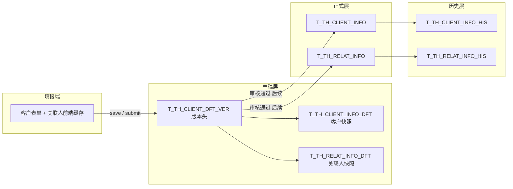

# 客户信息保存/提交与草稿审核重构技术方案

## 1. 文档说明

| 项           | 说明                                                                                                                                  |
| ------------ | ------------------------------------------------------------------------------------------------------------------------------------- |
| 范围         | 反洗钱融资端客户填报（KYC01010 / KYC01050）、客户信息表单（`workflow/prs01/base`）、保存/提交后端逻辑                                 |
| 目标         | 保存与提交均进入**草稿版本**；**合规审核通过**后才写入正式表；关联人改为**前端缓存、保存/提交时整包落库**                             |
| 不在本期     | 存量迁移、列表展示策略、证件到期联动、全链接「审核通过」、工作室 `call_reback` 时机调整、附件草稿化、KYC01020 合规侧「修改」隐藏      |
| 老表索引结论 | `T_TH_CLIENT_INFO` / `T_TH_CLIENT_INFO_HIS` 仅有 `CLIENT_ID` 普通索引；其余相关表无 P/U 约束与业务索引（`ALL_CONSTRAINTS` 查询 0 行） |

### 1.1 与现网兼容原则（主表/关联表字段不变）

**原则**：新表（版本头 + `_DFT` 快照）只承担「草稿与版本」；**写入正式表时，按正式表现有列名逐字段融入**，不新增、不重命名、不删减 `T_TH_CLIENT_INFO`、`T_TH_RELAT_INFO` 上的业务字段。其它模块（KYC01020 列表、视图 `vw_fxq_cust_info`、证件到期任务、工作室/项目查询、风险反馈等）继续**只读正式表原字段**即可，**尽量不改动**其 SQL 与页面逻辑。

| 环节                     | 做法                                                                                                                                                                        |
| ------------------------ | --------------------------------------------------------------------------------------------------------------------------------------------------------------------------- |
| 草稿快照 `_DFT`          | 列集合 = 正式表 **+ `VER_ID`**（见 §6.3、§6.4）；填报、审核比对只读 `_DFT` + 版本头                                                                                         |
| 审核通过写正式           | `P_TH_CLIENT_INFO_APPR`：`T_TH_CLIENT_INFO_DFT` → `T_TH_CLIENT_INFO`、`T_TH_RELAT_INFO_DFT` → `T_TH_RELAT_INFO`，**同名字段一一映射**（INSERT/UPDATE 与现网过程相同的列集） |
| 现网已约定不随保存改的列 | 写回正式时仍**不覆盖** `CLIENT_STATUS`、`CLIENT_BELONG`（与 `P_TH_CLIENT_INFO_S` 更新分支一致）；`DATA_STATUS` 写正式表时置 `'1'`（表示正式数据）                           |
| 必须动到的外围           | 仅「原来读主表草稿（`data_status=0`）或 tmp 关联」的填报链路改为读 `_DFT`；**只查正式数据的页面不改**                                                                       |

关联人同理：正式表 `T_TH_RELAT_INFO` 列不变；审核通过时按快照整包替换该客户正式关联人，字段与现网一致（含 BOMIS 扩展列）。

### 1.2 单一入口（非「二合一」）

**含义**

- **一种能力 = 一个 xwl 模块名**（路径不变）：例如新增仍走 `save_client.xwl`、编辑保存/提交仍走 `update_client.xwl`；将来在**该文件内**改调 `P_TH_CLIENT_INFO_DFT_S`。**不另建** `save_client_dft` 等与现网**并联**的第二套 URL。
- **不是二合一**：「保存」与「编辑保存/提交」仍是 **两个入口**（`save_client` 与 `update_client`），不合并成一个 xwl。
- **前端阶段**：后端/存储过程**只保留上述入口模块**；**过程体与 SQL 等你确认后再写**。React 可先按方案传 `SAVE_TYPE`、`BASE_VER_ID`、`batchList`；在后端切换前，现网 xwl 可能仍执行旧逻辑，以联调为准。
- **切换完成后**：各入口内**只**调草稿/审核过程（`P_TH_CLIENT_INFO_DFT_S` / `P_TH_CLIENT_INFO_APPR`），**禁止**再调 `P_TH_CLIENT_INFO_S`，也禁止 DFT 失败回落 S。

| 能力 | 唯一入口（模块名） | 切换后该入口内废弃的逻辑 |
| --- | --- | --- |
| 新增保存 | `save_client.xwl` | `P_TH_CLIENT_INFO_S` |
| 编辑保存/提交 | `update_client.xwl` | `P_TH_CLIENT_INFO_S` |
| 合规审核通过 | `P_TH_CLIENT_INFO_APPR` | 用 S 写正式 |
| 编辑页关联人 | 内存 + 上表 `batchList` | `save_organ_entity` 等 |
| 主表/关联查询 | `select_basic_info.xwl`、`select_related_info.xwl` 等 | union 老 draft / tmp |
| 工作室回写 | `call_reback.xwl` | — |

---

## 2. 现状与问题

### 2.1 当前链路

- 新增/编辑页「保存」「提交」均调用 `P_TH_CLIENT_INFO_S`，写入 `**THJS.T_TH_CLIENT_INFO**`。
- 提交时前端写死 `DATA_STATUS = '1'`，保存依赖入参 `DATA_TYPE`，丢失时默认正式，存在草稿未审即进合规视图的风险（原问题 P01）。
- 关联人在弹窗「提交」即写 `**T_TH_RELAT_INFO_TMP**`；页面保存时过程把临时表并入 `**T_TH_RELAT_INFO**` 并置 `DATA_STATUS = '1'`，且修改时会**先删正式表同名关联人**（见《关联人信息表逻辑.md》）。
- 删除关联人对正式/临时表**立即生效**，历史不完整。

### 2.2 本次要解决的问题

1. **正式表语义**：表中有效业务数据 = 已审核通过；未审核内容不得占用正式主表/正式关联表。
2. **保存 = 提交（数据落点）**：二者都写草稿版本；区别仅为版本状态（编辑中 / 待审核）及前端校验强度。
3. **关联人落库时机**：编辑过程仅改前端内存；点「保存」或「提交」时与客户主表同一事务写入草稿关联快照。
4. **可追溯**：线性版本，每次保存产生新版本，旧版本保留，便于后续对比「改了什么」（本期不做对比 UI，表结构预留）。

---

## 3. 目标架构

### 3.1 数据分层



#### 3.1.1 架构图说明：草稿层（左）与历史层（右）

架构图从左到右表示：**填报 → 草稿版本 → 审核通过后写正式 → 正式变更留痕**。其中草稿层「版本头 + 两张快照」、正式层后的 `_HIS` 是刻意拆分，不是多建几张表而已。

**草稿层：为什么是** `T_TH_CLIENT_DFT_VER` **+** `INFO_DFT` **+** `RELAT_INFO_DFT`

```
T_TH_CLIENT_DFT_VER（版本头，1 行/次保存）
        │
        ├── T_TH_CLIENT_INFO_DFT   （客户快照，1 行/版本）
        └── T_TH_RELAT_INFO_DFT  （关联人快照，N 行/版本）
```

| 设计                     | 原因                                                                                                                                                                                                                                                                       |
| ------------------------ | -------------------------------------------------------------------------------------------------------------------------------------------------------------------------------------------------------------------------------------------------------------------------- |
| 版本头单独成表           | 同一客户会有 v1、v2、v3…，需要统一管理 `VER_NO`、`DFT_STATUS`（编辑中/待审核/驳回/已通过）、提交人/时间、后续审核与工作室回写等。这些是**流程元数据**，不属于客户业务字段，不应在客户快照里每版重复一行。待审核列表、待审核锁定、并发校验 `BASE_VER_ID` 只查版本头即可。   |
| 客户与关联人各一张快照   | 与现网一致：主表**一行**客户、关联表**多行**（五类角色、同人多角色）。一次保存 = 一个完整业务包：`VER_ID` 下 1 行主表快照 + 整包关联人快照，便于以后按版本对比「主表 diff + 按 `RELATED_ID` diff 关联人」。合并成一张宽表或 JSON 不利于查询、BOMIS、以及与正式表字段对齐。 |
| 每次保存新版本、旧版不删 | 线性版本 + 后续「对比改了什么」依赖**只追加、不覆盖历史版本**。新版本写入新的 `VER_ID` 及对应快照；「整包插入关联人」指**该新版本内**的全量快照，不是删除旧版本的快照行。                                                                                                  |

**历史层：为什么正式表之后还有** `T_TH_CLIENT_INFO_HIS` **/** `T_TH_RELAT_INFO_HIS`

| 对比项   | 草稿 `_DFT`                                | 历史 `_HIS`                                           |
| -------- | ------------------------------------------ | ----------------------------------------------------- |
| 存什么   | 尚未审核通过（或曾提交待审）的**候选数据** | **曾经生效过的正式数据**备份                          |
| 典型用途 | 填报、合规审阅待审版本                     | 审计追溯、「审核通过前正式长什么样」                  |
| 与正式表 | 审核通过前**不写**正式表                   | 在**覆盖正式表之前/之时**写入，正式表始终表示当前生效 |

草稿可以有多版、可驳回反复改，正式表在审核通过前可以不变；`_HIS` 记录的是动正式表前的旧正式内容（与现网 `P_TH_CLIENT_INFO_S` 更新前 insert his 的习惯一致）。重构后主要在 `**P_TH_CLIENT_INFO_APPR` 审核通过写正式前备份到 `_HIS`。关联人单独留历史，避免只剩主表历史、关联人增删改无法追溯（现网关联人历史不完整的问题）。

**三者关系（一句话）**

- **草稿** `_DFT`：填报过程中的候选版本，可多版、可对比，不进正式库。
- **正式** `INFO` **/** `RELAT_INFO`：合规认可后的当前真相。
- **历史** `_HIS`：正式表每次变更前的留痕，与草稿版本并行存在、职责不同。

### 3.2 版本模型（线性）

- 每个 `CLIENT_ID` 对应**一串递增版本** `VER_NO = 1, 2, 3 …`。
- **当前最新版本** = 该客户下 `VER_NO` **最大** 的那条版本头。保存时仅 **INSERT** 新版本头（`VER_NO = MAX(VER_NO)+1`），不 UPDATE 旧版本头。
- **查最新示例**：`WHERE CLIENT_ID = ? AND VER_NO = (SELECT MAX(VER_NO) FROM T_TH_CLIENT_DFT_VER WHERE CLIENT_ID = ?)`；列表/批量可用 `ROW_NUMBER() OVER (PARTITION BY CLIENT_ID ORDER BY VER_NO DESC)`。
- **不支持并行多草稿**（本期）：两人同时编辑时，后保存者若 `BASE_VER_ID` ≠ 当前最新版本的 `VER_ID`（即 `MAX(VER_NO)` 对应行），拒绝保存并提示刷新。
- **待审核不可再改**：最新版本（`MAX(VER_NO)`）的 `DFT_STATUS = '1'` 时，禁止保存/提交（只读打开）。

### 3.3 关联人 `RELATED_ID` 规则

- 从正式表加载的关联人：前端携带原 `RELATED_ID`，各版本与审核通过后写回正式表时**保持不变**。
- 本次编辑新增的关联人：在**第一次**写入草稿时由后端生成 `RELATED_ID`（`SYS_GUID()`），后续版本沿用该 id。
- 跨版本 diff 时以 `(CLIENT_ID, RELATED_ID, RELATED_TYPE)` 对齐；删除 = 新版本中不再出现该 id+类型组合。

### 3.4 角色与入口（本期约定）

| 入口                 | 行为                                                                         |
| -------------------- | ---------------------------------------------------------------------------- |
| KYC01010 新增 / 编辑 | 项目人员：保存/提交 → 草稿版本                                               |
| KYC01050 客户维护    | 同上                                                                         |
| KYC01020 修改        | 后续隐藏；合规不通过该入口改数                                               |
| 合规审核通过         | 后续在全链接/Java 实现，调用 `P_TH_CLIENT_INFO_APPR`（本期仅设计，可不落地） |

附件 `**T_TH_CLIENT_FILE**`：维持「上传即落库」，不纳入草稿版本（后续再优化）。

工作室 `**call_reback**`：本期仍可在提交成功后按现网逻辑调用；版本头表预留 `CALLBACK_*` 字段，便于以后改为「审核通过后回写」。

---

## 4. 版本状态与操作

### 4.1 `DFT_STATUS`（版本头表）

| 值  | 含义   | 填报人                                   | 合规                    |
| --- | ------ | ---------------------------------------- | ----------------------- |
| `0` | 编辑中 | 可继续保存（产生新版本）或提交           | 不可审                  |
| `1` | 待审核 | **不可**保存/提交（锁定）                | 审阅、通过/驳回（后续） |
| `2` | 已驳回 | 可修改后保存或再次提交                   | —                       |
| `3` | 已通过 | 只读历史版本；再次修改基于正式表开新版本 | —                       |

### 4.2 `SAVE_TYPE`（版本头表）

| 值       | 触发             | 写入后 `DFT_STATUS`                              |
| -------- | ---------------- | ------------------------------------------------ |
| `save`   | 编辑页「保存」   | `0`（若从驳回态保存，仍为 `0`，直至再次 submit） |
| `submit` | 「提交并关闭」等 | `1`                                              |

说明：从状态 `2` 提交 → 新版本 `DFT_STATUS = '1'`；从状态 `0` 保存 → 新版本 `DFT_STATUS = '0'`。

### 4.3 打开编辑页加载规则

1. 查该客户 `**VER_NO` 最大 的版本头（当前最新）。
2. 若存在且 `DFT_STATUS IN ('0','2')`：加载该版本的 `T_TH_CLIENT_INFO_DFT` + `T_TH_RELAT_INFO_DFT`，可编辑；前端记录 `BASE_VER_ID = VER_ID`。
3. 若存在且 `DFT_STATUS = '1'`：只读展示该版本，禁止保存/提交。
4. 若不存在，或最新版本为 `3`：从 `**T_TH_CLIENT_INFO` + `T_TH_RELAT_INFO**` 加载，作为新版本的基准；`BASE_VER_ID` 可为上一通过版本的 `VER_ID` 或空（首次新建客户无正式行时仅草稿）。

### 4.4 保存/提交过程（`P_TH_CLIENT_INFO_DFT_S`）

**前置校验（与现网对齐部分）**

- 机构：其他 `CLIENT_ID` 下同名（`client_belong='1'`）→ 拒绝。
- 全类型：其他 `CLIENT_ID` 下相同证件号 → 拒绝。
- 校验范围：**正式表** + **其他客户的最新有效草稿**（最新版本且 `DFT_STATUS IN ('0','1','2')`），不含历史版本行。

**版本锁**

- 若该客户最新版本 `DFT_STATUS = '1'` → 返回错误「待审核期间不可修改」。
- 若入参 `BASE_VER_ID` ≠ 当前最新 `VER_ID` → 返回错误「数据已被更新，请刷新」。

**写入（单事务，过程内不 commit）**

1. 插入版本头：新 `VER_ID`、`VER_NO = MAX(VER_NO)+1`（按 `CLIENT_ID`）、`BASE_VER_ID`、`DFT_STATUS`、`SAVE_TYPE`、操作人/时间；提交时写 `SUBMIT_USER/SUBMIT_TIME`。
2. 插入一行 `T_TH_CLIENT_INFO_DFT`（字段与正式主表一致 + `VER_ID`）。
3. 批量插入 `T_TH_RELAT_INFO_DFT`（前端 JSON 整包；无 `RELATED_ID` 的行后端生成）。
4. **首次**出现该 `CLIENT_ID`（正式表无行且尚无维护人记录）：插入 `T_MAINTAINER_INFO`（与现网 `P_TH_CLIENT_INFO_S` 一致逻辑）。

**不再执行（本方案下废弃的路径）**

- 保存/提交时调用 `P_TH_CLIENT_INFO_S` 写正式表。
- 保存时 `T_TH_RELAT_INFO_TMP` → `T_TH_RELAT_INFO` 的合并及「全量改正式关联人状态为 1」。

### 4.5 审核通过（后续，`P_TH_CLIENT_INFO_APPR` 设计要点）

1. 校验目标版本 `DFT_STATUS = '1'`。
2. 备份：正式主表/关联表当前内容入 `_HIS`（列与现网备份一致，保证其它依赖 `_HIS` 的逻辑不受影响）。
3. **主表融入（核心）**：从 `T_TH_CLIENT_INFO_DFT` 按 **与 `T_TH_CLIENT_INFO` 相同的列名** UPDATE/INSERT；**排除**不覆盖项：`CLIENT_STATUS`、`CLIENT_BELONG`；`DATA_STATUS` 置 `'1'`；`UPDATE_USER`/`UPDATE_TIME` 按操作更新。不引入正式表没有的新字段。
4. **关联人融入**：该客户 `DELETE T_TH_RELAT_INFO WHERE CLIENT_ID = ?`，再从 `T_TH_RELAT_INFO_DFT` **按正式关联表列 INSERT**（不含 `VER_ID`）；`RELATED_ID` 与快照一致。
5. 版本头 `DFT_STATUS = '3'`；审核意见、审核人/时间以 `T_TH_APPR_*` 为准（见 §6.2 与审核表关联方式，避免与版本头重复落库）。

---

## 5. 前端改造要点

### 5.1 关联人

- 五类关联人列表维护在 Vue 内存（如 `relatedInfo1`…`relatedInfo5` 或统一 `relatedList`）。
- 新增/编辑/删除：只改内存；「同名一改多改」、查重逻辑从现网 `saveEditForm` / `update_organ_entity` **迁移到前端**。
- 保存/提交：请求体增加 `batchList`（或按类型分数组），后端写入 `T_TH_RELAT_INFO_DFT`。
- 废弃调用：`save_organ_entity`、`update_organ_entity`、`delete_single_entity`（编辑页）；新增页取消时不再依赖清空 `T_TH_RELAT_INFO_TMP`（可选保留空实现兼容旧会话）。
- **BOMIS**：`select_bomis_benefit_scinfo` / `add_bomis_benefit_scinfo` / `online_bomis_check` 改为读前端缓存中的受益所有人数据（不再 union 正式表+临时表）。

### 5.2 主表

- **`save_client` / `update_client`**（原 xwl 入口，后端切换后）调用 `P_TH_CLIENT_INFO_DFT_S`，传 `SAVE_TYPE`、`BASE_VER_ID`、关联人 `batchList`；入口内**禁止**再调 `P_TH_CLIENT_INFO_S`。工作室 `KEY` 仍由提交成功后 `call_reback` 处理。
- 去掉对 `DATA_STATUS` 写正式表的依赖；列表「数据状态」改为读版本头 `DFT_STATUS` + 是否存在正式行（展示规则后续定）。

### 5.3 交互

- 关闭/返回：若内存有未保存变更，提示确认（与是否落库草稿无关）。
- 待审核：页面只读，隐藏或禁用保存/提交按钮。

---

## 6. 数据库设计

### 6.1 表清单

| 表名                   | 用途                                                            |
| ---------------------- | --------------------------------------------------------------- |
| `T_TH_CLIENT_DFT_VER`  | 草稿版本头：状态、序号（`VER_NO` 判最新）、提交/审核/工作室预留 |
| `T_TH_CLIENT_INFO_DFT` | 某一版本的客户主表字段快照（一行/版本）                         |
| `T_TH_RELAT_INFO_DFT`  | 某一版本的关联人全量快照（多行/版本）                           |

正式表、历史表、审核意见表、附件表、维护人表：**结构不变**；读写规则按上文调整。

**字段说明约定**：下表在《建表.md》列结构基础上增加 **「作用」** 列。正式表 `T_TH_CLIENT_INFO`、`T_TH_RELAT_INFO` 的业务含义与 §6.3、§6.4 中**除** `VER_ID` **外**各字段「作用」相同；历史表 `_HIS` 多 `HIS_TIME`（及关联人 `HIS_ID`），含义为备份时点快照。

### 6.2 `T_TH_CLIENT_DFT_VER`（版本头）

> 本表为**新增**，字段含义见下表「作用」列。`DFT` = Draft（草稿）。

| 字段名          | 类型          | 可空 | 默认       | 取值/说明                                 | 作用                                                                             |
| --------------- | ------------- | ---- | ---------- | ----------------------------------------- | -------------------------------------------------------------------------------- |
| VER_ID          | VARCHAR(32)   | N    | SYS_GUID() | 主键                                      | 某一草稿版本的唯一 id；与客户快照、关联人快照的 `VER_ID` 关联                    |
| CLIENT_ID       | VARCHAR(50)   | N    |            | 客户号                                    | 归属哪个客户；与 `VER_NO` 组合定位版本序列                                       |
| VER_NO          | INT           | N    |            | 1, 2, 3…                                  | 同一客户内单调递增；**当前最新版** = `MAX(VER_NO)`                               |
| BASE_VER_ID     | VARCHAR(32)   | Y    |            | 上一版 `VER_ID`                           | **乐观锁**：保存时须等于库中最新版 `VER_ID`，否则拒绝；并记录版本血缘供以后 diff |
| DFT_STATUS      | CHAR(1)       | N    |            | 0 编辑中 / 1 待审核 / 2 已驳回 / 3 已通过 | 本版在审核流程中的状态；`1` 时填报端不可再改                                     |
| SAVE_TYPE       | VARCHAR(10)   | Y    |            | `save` / `submit`                         | 本版由「保存」还是「提交」产生；配合 `DFT_STATUS` 区分存盘与提交待审             |
| CREATE_USER     | VARCHAR(50)   | Y    |            | 登录账号                                  | 生成本版本的操作人（保存或提交人）                                               |
| CREATE_TIME     | TIMESTAMP(6)  | Y    | SYSDATE    |                                           | 本版本写入库时间；可用于排序、审计                                               |
| SUBMIT_USER     | VARCHAR(50)   | Y    |            |                                           | 仅 `SAVE_TYPE=submit` 时填写；表示提交待审的人                                   |
| SUBMIT_TIME     | TIMESTAMP(6)  | Y    |            |                                           | 提交待审时间                                                                     |
| AUDIT_ID        | VARCHAR(80)   | Y    |            | 同 `T_TH_APPR_LIST`                       | 与本版审核结论绑定的审核批次 id（后续全链接审核通过/驳回时回填）                 |
| AUDIT_USER      | VARCHAR(50)   | Y    |            |                                           | 审核通过或驳回的操作人                                                           |
| AUDIT_TIME      | TIMESTAMP(6)  | Y    |            |                                           | 审核操作时间                                                                     |
| CALLBACK_KEY    | VARCHAR(100)  | Y    |            | 工作室 `eventRecordId`                    | **预留**：从工作室打开表单时的 KEY；便于以后改「审核通过后再 call_reback」       |
| CALLBACK_USER   | VARCHAR(50)   | Y    |            | 工作室 `updator`                          | **预留**：回写工作室时的用户                                                     |
| CALLBACK_STATUS | CHAR(1)       | Y    |            | 0 未回写 / 1 成功 / 2 失败                | **预留**：工作室接口回写结果                                                     |
| REMARK          | VARCHAR(1000) | Y    |            | 自由文本                                  | 版本级备注（运维/扩展用）                                                        |

**索引建议**

- PK：`VER_ID`
- UK：`(CLIENT_ID, VER_NO)` — 序号唯一；**最新版**即同 `CLIENT_ID` 下 `VER_NO` 最大的一条（UK 已支持按客户+序号定位，查 MAX 时可配合 `(CLIENT_ID, VER_NO DESC)` 索引，视执行计划可选）
- IDX：`(CLIENT_ID, DFT_STATUS)` — 待审核列表（后续合规视图）

### 6.3 `T_TH_CLIENT_INFO_DFT`（客户快照）

> 在 `**T_TH_CLIENT_INFO`（见《建表.md》）** 全部列基础上**增加** `VER_ID`；类型、长度与正式表一致。下表「作用」对正式表同样适用；**草稿特有说明写在作用列括号内。

| 字段名                        | 类型（同正式表） | 取值/说明                             | 作用                                                                                          |
| ----------------------------- | ---------------- | ------------------------------------- | --------------------------------------------------------------------------------------------- |
| VER_ID                        | VARCHAR(32)      | 关联版本头                            | **草稿专用**：本行属于哪一版；PK；与 `T_TH_CLIENT_DFT_VER` 1:1                                |
| CLIENT_ID                     | VARCHAR(50)      | 客户号                                | 业务主键之一；与正式表相同                                                                    |
| CLIENT_NAME                   | VARCHAR(200)     | 客户全称                              | 机构为公司名、自然人为姓名；机构重名校验字段                                                  |
| ORGAN_FLAG                    | CHAR(1)          | 0 自然人 / 1 机构                     | 客户类型；新增后不可改                                                                        |
| ID_TYPE                       | VARCHAR(2)       | 字典                                  | 客户本人证件类型                                                                              |
| ID_NO                         | VARCHAR(50)      |                                       | 证件号码；跨客户唯一性校验（含他人草稿）                                                      |
| ID_BEGINDATE                  | VARCHAR(20)      |                                       | 证件有效期起                                                                                  |
| ID_ENDDATE                    | VARCHAR(20)      |                                       | 证件有效期止；证件到期任务会读正式表                                                          |
| CLIENT_BELONG                 | CHAR(1)          | 1 融资端 / 2 投资端                   | 业务线归属；融资端 KYC 一般为 1；**审核写回正式表时不覆盖**                                   |
| NATIONALITY                   | VARCHAR2(100)    | 字典                                  | 国籍（自然人等）                                                                              |
| BIRTHDAY                      | VARCHAR(20)      |                                       | 出生日期（自然人）                                                                            |
| OFFICE_ADDRESS                | VARCHAR(500)     |                                       | 办公/联系地址文字                                                                             |
| PROVINCE / CITY / DISTRICT    | VARCHAR          | 字典                                  | 办公地址省市区                                                                                |
| REGISTER_COUNTRY              | VARCHAR2(20)     |                                       | 注册国家（机构）                                                                              |
| REGISTER_MONEY_TYPE           | VARCHAR(10)      |                                       | 注册资本币种（机构）                                                                          |
| REGISTER_FUND                 | FLOAT            |                                       | 注册资本（机构）                                                                              |
| INDUSTRY_TYPE                 | VARCHAR(2)       | 字典                                  | 行业分类（一级代码）                                                                          |
| INDUSTRY_NAME                 | VARCHAR2(200)    |                                       | 行业名称展示                                                                                  |
| INDUSTRY_TYPE1                | CHAR(1)          |                                       | 行业相关扩展分类                                                                              |
| TEL                           | VARCHAR(50)      |                                       | 联系电话                                                                                      |
| SETUP_DATE                    | VARCHAR(20)      |                                       | 成立日期（机构）                                                                              |
| BUSI_SCOPE                    | VARCHAR(4000)    |                                       | 经营范围（机构）                                                                              |
| IS_OBJECT_REPORT              | VARCHAR(500)     |                                       | 是否工作室主体填报等标识                                                                      |
| ASSOCIATED_DATE               | VARCHAR(20)      |                                       | 建立业务关系日期；首次提交常写当天                                                            |
| REMARK                        | VARCHAR(4000)    |                                       | 备注                                                                                          |
| CREATE_USER / CREATE_TIME     |                  |                                       | 客户首次创建人/时间（快照中可沿用或按版本写）                                                 |
| UPDATE_USER / UPDATE_TIME     |                  |                                       | 本版保存时的更新人/时间                                                                       |
| IS_SPECIAL                    | CHAR(1)          | 是否                                  | 是否特殊情况客户                                                                              |
| CLIENT_TYPE                   | VARCHAR(10)      | 多选拼接                              | 客户类型（特殊情况区）                                                                        |
| CLIENT_TYPE_OTHER             | VARCHAR(200)     |                                       | 客户类型选「其他」时的说明                                                                    |
| SPECIAL_MATTERS               | VARCHAR(10)      |                                       | 特殊事项类型                                                                                  |
| SPECIAL_MATTERS_OTHER         | VARCHAR(200)     |                                       | 特殊事项其他说明                                                                              |
| MISSING_INFORMATION           | VARCHAR(200)     |                                       | 缺失信息说明                                                                                  |
| MISSING_DRAFT                 | VARCHAR(200)     |                                       | 缺失底稿说明                                                                                  |
| SPECIAL_REASON                | VARCHAR(4000)    |                                       | 特殊原因                                                                                      |
| COMPLETED_CDD                 | VARCHAR(4000)    |                                       | 已完成 CDD 说明                                                                               |
| LOW_RISK_EXPLANATION          | VARCHAR(4000)    |                                       | 低风险说明                                                                                    |
| TAKE_MEASURES                 | VARCHAR(4000)    |                                       | 已采取措施                                                                                    |
| COMMUNICATION_RECORDS         | VARCHAR(4000)    |                                       | 沟通记录；常存附件目录 key（`clientId+comm`）                                                 |
| AGREE_RECORDS                 | VARCHAR(4000)    |                                       | 协议记录附件 key                                                                              |
| OTHER_RECORDS                 | VARCHAR(4000)    |                                       | 其他材料附件 key                                                                              |
| WORK_TYPE                     | CHAR(1)          | 0 创建 / 1 更新                       | 最近一次填报操作类型（与现网一致）                                                            |
| CLIENT_STATUS                 | VARCHAR(2)       | 0 正常 / 1 失效 / 2 强限制 / 3 弱限制 | **合规管控状态**；快照供页面展示；**审核写回正式表时不覆盖**（仍由 `P_FXQ_CUST_RZ_L` 等修改） |
| DATA_STATUS                   | CHAR(1)          | 现网 0 草稿 / 1 正式                  | 现网语义；**新流程以版本头** `DFT_STATUS` **为准**，本字段在草稿表可冗余或固定 0              |
| RELATED_PROJ                  | VARCHAR(500)     |                                       | 关联项目（预留）                                                                              |
| IF_RISK_CLIENT                | VARCHAR(50)      |                                       | 是否风险客户相关标识                                                                          |
| RISK_LIST_TYPE                | VARCHAR(50)      |                                       | 风险名单类型                                                                                  |
| PROBLEM_DESC                  | VARCHAR(4000)    |                                       | 问题描述                                                                                      |
| GRADE_VALUE                   | CHAR(1)          | 字典                                  | 风险等级                                                                                      |
| IF_RISK_LIST                  | VARCHAR(2)       |                                       | 是否风险名单                                                                                  |
| GENDER                        | CHAR(1)          |                                       | 性别（自然人）                                                                                |
| INCOME                        | VARCHAR(200)     |                                       | 收入（自然人）                                                                                |
| PROFESSION_CODE               | VARCHAR(200)     | 字典                                  | 职业分类                                                                                      |
| POSITION                      | VARCHAR(100)     |                                       | 职务                                                                                          |
| WORK_PLACE                    | VARCHAR(100)     |                                       | 工作单位                                                                                      |
| ZIPCODE                       | VARCHAR(20)      |                                       | 邮编                                                                                          |
| FILLIN_DATE                   | VARCHAR(20)      |                                       | 填报日期                                                                                      |
| ID_ADDRESS                    | VARCHAR(500)     |                                       | 证件地址                                                                                      |
| PROVINCE1 / CITY1 / DISTRICT1 | VARCHAR          |                                       | 证件地址省市区                                                                                |
| ADDRESS                       | VARCHAR(500)     |                                       | 常住/联系地址                                                                                 |
| PROVINCE2 / CITY2 / DISTRICT2 | VARCHAR          |                                       | 常住地址省市区                                                                                |
| CUST_BIZ                      | VARCHAR2(20)     | 投行 / 测试                           | 业务分类；`admin` 创建多为测试                                                                |

**索引建议**

- PK：`VER_ID`
- IDX：`CLIENT_ID`

### 6.4 `T_TH_RELAT_INFO_DFT`（关联人快照）

> 在 `**T_TH_RELAT_INFO`（见《建表.md》）** 全部列基础上**增加 `VER_ID`。同一版本内多行（多角色、多人）。`RELATED_TYPE`：1 法定代表人、2 控股股东、3 实际控制人、4 授权代表人、5 受益所有人。

| 字段名                                            | 类型（同正式表） | 取值/说明         | 作用                                                                                  |
| ------------------------------------------------- | ---------------- | ----------------- | ------------------------------------------------------------------------------------- |
| VER_ID                                            | VARCHAR(32)      |                   | **草稿专用**：所属草稿版本；PK 组成部分                                               |
| CLIENT_ID                                         | VARCHAR(50)      |                   | 所属客户                                                                              |
| RELATED_ID                                        | VARCHAR(32)      | GUID              | **跨版本稳定 id**；从正式加载则沿用；新增关联人首次落草稿时生成；审核通过后写回正式表 |
| RELATED_TYPE                                      | CHAR(1)          | 1～5              | 关联人类型（角色）                                                                    |
| ORGAN_FLAG                                        | CHAR(1)          | 0 自然人 / 1 机构 | 该关联人是自然人还是法人主体                                                          |
| RELATED_NAME                                      | VARCHAR(200)     |                   | 姓名或机构名称；「同名一改多改」按此姓名批量同步证件等                                |
| NATIONALITY                                       | VARCHAR(50)      | 字典              | 国籍                                                                                  |
| ID_TYPE / ID_NO                                   |                  |                   | 证件类型、号码                                                                        |
| ID_BEGINDATE / ID_ENDDATE                         | VARCHAR(20)      |                   | 证件有效期；到期提醒会读正式表关联人                                                  |
| BIRTHDAY                                          | VARCHAR(20)      |                   | 出生日期                                                                              |
| SHAREHOLDING_RATIO                                | VARCHAR(20)      |                   | 持股/受益比例（受益所有人等）                                                         |
| BENEFICIARY                                       | VARCHAR(20)      |                   | 受益人类型等（现网受益人字段）                                                        |
| ADDRESS                                           | VARCHAR(300)     |                   | 地址（受益所有人）                                                                    |
| IS_GOVERNMENT_DEPT                                | CHAR(1)          |                   | 是否政府部门                                                                          |
| OBJECT_ID                                         | VARCHAR(4000)    |                   | 历史/外部对象 id（现网编辑链路遗留，可空）                                            |
| CREATE_USER / CREATE_TIME                         |                  |                   | 创建人、创建时间                                                                      |
| UPDATE_USER / UPDATE_TIME                         |                  |                   | 本版保存时的更新人、时间                                                              |
| RELATED_KEY                                       | VARCHAR2(50)     |                   | 扩展关联键                                                                            |
| DATA_STATUS                                       | CHAR(1)          | 现网 0/1          | 现网临时/正式标记；**新流程以版本为准**，快照内可统一存 0 或不依赖                    |
| GENDER                                            | VARCHAR2(4)      |                   | 性别                                                                                  |
| MOBNO1 / MOBNO2                                   | VARCHAR2(16)     |                   | 手机号（法定代表人、授权代表人等）                                                    |
| ACTCTRL                                           | VARCHAR2(2)      | Y/N               | 是否实际控制（BOMIS 受益人）                                                          |
| ACTHDRAT                                          | NUMERIC(20,2)    |                   | 持股比例                                                                              |
| SHARERATIOSTARTDATE / SHARERATIOENDDATE           | TIMESTAMP        |                   | 持股期限                                                                              |
| ACTCTRLCPNY                                       | VARCHAR2(1)      |                   | 实际控制公司类型等                                                                    |
| ACTCTRLTYPE                                       | VARCHAR2(10)     |                   | 实际控制方式（可多选存串）                                                            |
| OBTAINACTDATE / TERMINATIONACTDATE                | TIMESTAMP        |                   | 获得/终止实际控制日期                                                                 |
| ACTOTHERFORMS                                     | VARCHAR2(48)     |                   | 其他控制形式                                                                          |
| ACTCONUPPERMARKET                                 | VARCHAR2(2)      |                   | 是否上市                                                                              |
| ACTCONUPPERENTNAME / ACTCONUNISCID                |                  |                   | 上层企业名称、统一社会信用代码                                                        |
| PRIBENFIT                                         | VARCHAR2(2)      |                   | 是否 primary 受益                                                                     |
| ACTOWNERPROFITRATIO                               | NUMERIC(20,2)    |                   | 受益所有权比例                                                                        |
| PROFITRATIOSTARTDATE / PROFITRATIOENDDATE         | TIMESTAMP        |                   | 受益所有权期限                                                                        |
| ACTOWNERPROFITRATIOVOTE                           | NUMERIC(20,2)    |                   | 表决权比例                                                                            |
| PROFITRATIOVOTESTARTDATE / PROFITRATIOVOTEENDDATE | TIMESTAMP        |                   | 表决权期限                                                                            |
| SENIORMGR / SENIORMGRPOS                          |                  |                   | 高级管理人员及职位（BOMIS）                                                           |
| ACTDAILYMGMTPOSTOTHER                             | VARCHAR2(48)     |                   | 日常管理其他职位                                                                      |
| SENIORMGRCN / SENIORMGRPOSCN                      |                  |                   | 中文版高管标识/职位                                                                   |
| OWNERRIGHTMGMTPOSTOTHER                           | VARCHAR2(48)     |                   | 权益管理其他职位                                                                      |
| BNF_TYPE                                          | VARCHAR2(20)     | NA/NB 等          | 受益所有人类型编码（BOMIS 核验）                                                      |
| BO_TYPE                                           | VARCHAR2(5)      |                   | 受益人类型扩展                                                                        |
| COMPANY_TYPE                                      | VARCHAR2(5)      |                   | 公司类型（BOMIS 主体）                                                                |
| FULL_INFO_FLAG                                    | VARCHAR2(5)      |                   | 信息是否完整标记                                                                      |

**索引建议**

- PK：`(VER_ID, RELATED_ID, RELATED_TYPE)` — 同一人在同一版本可多角色（与现网一致）
- IDX：`(VER_ID, CLIENT_ID)`
- IDX：`(CLIENT_ID, RELATED_ID)` — 跨版本追踪同一关联人（可选）

### 6.5 建表示例（达梦 DM8 风格）

以下为结构示例，字段长度与现网表保持一致；上线前在测试库执行并核对 `GET_DDL`。

```sql
-- 1. 版本头
CREATE TABLE "THJS"."T_TH_CLIENT_DFT_VER" (
  "VER_ID"           VARCHAR(32) DEFAULT SYS_GUID() NOT NULL,
  "CLIENT_ID"        VARCHAR(50) NOT NULL,
  "VER_NO"           INT NOT NULL,
  "BASE_VER_ID"      VARCHAR(32),
  "DFT_STATUS"       CHAR(1) NOT NULL,
  "SAVE_TYPE"        VARCHAR(10),
  "CREATE_USER"      VARCHAR(50),
  "CREATE_TIME"      TIMESTAMP(6) DEFAULT SYSDATE,
  "SUBMIT_USER"      VARCHAR(50),
  "SUBMIT_TIME"      TIMESTAMP(6),
  "AUDIT_ID"         VARCHAR(80),
  "AUDIT_USER"       VARCHAR(50),
  "AUDIT_TIME"       TIMESTAMP(6),
  "CALLBACK_KEY"     VARCHAR(100),
  "CALLBACK_USER"    VARCHAR(50),
  "CALLBACK_STATUS"  CHAR(1),
  "REMARK"           VARCHAR(1000),
  CONSTRAINT "PK_TH_CLIENT_DFT_VER" PRIMARY KEY ("VER_ID")
) STORAGE(ON "TS_BASIC_THJS", CLUSTERBTR);

CREATE UNIQUE INDEX "UK_DFT_VER_CLIENT_NO"
  ON "THJS"."T_TH_CLIENT_DFT_VER"("CLIENT_ID","VER_NO");

-- 2. 客户快照：建议用脚本从 T_TH_CLIENT_INFO 列定义生成并追加 VER_ID
-- 3. 关联人快照：建议用脚本从 T_TH_RELAT_INFO 列定义生成并追加 VER_ID
```

客户/关联人快照表字段较多，**推荐**在库中执行：

```sql
-- 伪代码：复制列定义后加 VER_ID，再 CREATE TABLE ... AS SELECT ... WHERE 1=0
-- 或使用 DBMS_METADATA.GET_DDL 导出正式表后手工加 VER_ID 与主键
```

---

## 7. 接口与存储过程

路径约定：填报相关 xwl 位于 `modules/aml_monitor/workflow/prs01/dataSource/`；工作室回写位于 `modules/interface/customerInfoCheck/`。

**文档范围**：仅列**现网填报链路实际调用**或**改造后保留**的对象。工程里同名加后缀的副本（如 `*1`）、本地/测试页（如 `*_test`）未列入，避免与正式方案混淆。

### 7.1 存储过程

| 对象                     | 状态                   | 做什么事                                                                                                                                                                                                    | 读/写表                                                                                                                       | 谁调用                                                           | 备注                                                                                                                                          |
| ------------------------ | ---------------------- | ----------------------------------------------------------------------------------------------------------------------------------------------------------------------------------------------------------- | ----------------------------------------------------------------------------------------------------------------------------- | ---------------------------------------------------------------- | --------------------------------------------------------------------------------------------------------------------------------------------- |
| `P_TH_CLIENT_INFO_DFT_S` | **新建**               | 填报「保存/提交」：重名与证件号校验；待审核锁、并发校验 `BASE_VER_ID`；插入版本头（`VER_NO+1`）；写客户/关联人**草稿快照**；首次客户写 `T_MAINTAINER_INFO`                                                  | 写 `T_TH_CLIENT_DFT_VER`、`T_TH_CLIENT_INFO_DFT`、`T_TH_RELAT_INFO_DFT`；读正式表/他人最新草稿做校验；**不写**正式主表/关联表 | `save_client.xwl` / `update_client.xwl`（原入口）               | 过程内不 `commit`，由 xwl 统一事务；入参含主表全字段、`SAVE_TYPE`、`BASE_VER_ID`、关联人 batch（JSON）；**禁止内部调用 `P_TH_CLIENT_INFO_S`** |
| `P_TH_CLIENT_INFO_APPR`  | **新建（后续）**       | 合规**审核通过**：备份当前正式数据到 `_HIS`；将指定 `VER_ID` 的 `INFO_DFT`/`RELAT_DFT` **同名列**融入正式表（**不覆盖** `CLIENT_STATUS`、`CLIENT_BELONG`；正式 `DATA_STATUS='1'`）；版本头 `DFT_STATUS='3'` | 读 `_DFT`；写 `T_TH_CLIENT_INFO`、`T_TH_RELAT_INFO`、`_HIS`、更新 `T_TH_CLIENT_DFT_VER`；**正式表不新增字段**                 | 全链接/Java 审核通过（待落地）                                   | 关联人通常按客户 delete 正式后 insert 快照；不含草稿列 `VER_ID`                                                                               |
| `P_TH_CLIENT_INFO_S`     | **现网，填报链路退役** | 保存/提交直接写**正式**主表；tmp 关联人并进正式、改关联人 `DATA_STATUS` 等                                                                                                                                  | 写 `T_TH_CLIENT_INFO`、`T_TH_RELAT_INFO`、tmp/his 等                                                                          | **仅**现网 `save_client` / `update_client`（React 填报**禁止**） | 与 `P_TH_CLIENT_INFO_DFT_S` **并存但不交叉调用**；**正式表结构不变**                                                                          |

### 7.2 xwl（查询）

| 文件                      | 状态 | 做什么事                                               | 读表                                                                                                                                                                           | 谁调用（前端）                                | 改造要点                                     |
| ------------------------- | ---- | ------------------------------------------------------ | ------------------------------------------------------------------------------------------------------------------------------------------------------------------------------ | --------------------------------------------- | -------------------------------------------- |
| `select_basic_info.xwl`   | 改造 | 加载编辑/预览页**客户主表**一条                        | 现网：`t_th_client_info` union 老 draft；**改后**：最新版可编辑（`DFT_STATUS` 0/2）→ `T_TH_CLIENT_INFO_DFT`；否则 → `T_TH_CLIENT_INFO`；返回中带 `VER_ID`/`BASE_VER_ID` 供保存 | `base_edit.xwl`、`base.xwl` 等 `getBasicInfo` | 去掉老 `t_th_client_info_draft`              |
| `select_related_info.xwl` | 改造 | 按 `CLIENT_ID` + `RELATED_TYPE` 查**某一类关联人**列表 | 现网：正式 union `t_th_relat_info_tmp`；**改后**：有当前 `VER_ID` → `T_TH_RELAT_INFO_DFT`；否则 → `T_TH_RELAT_INFO`                                                            | 编辑页五栏 `getRelatedInfo`                   | 关联人改前端缓存后，打开页仍可能调一次灌内存 |

### 7.3 xwl（保存 / 提交）

| 文件                  | 状态     | 做什么事                                                                         | 调用的过程 / 写库（切换后）                          | 谁调用（前端）                  | 改造要点                                                                      |
| --------------------- | -------- | -------------------------------------------------------------------------------- | ---------------------------------------------------- | ------------------------------- | ----------------------------------------------------------------------------- |
| `update_client.xwl`   | **改造** | 编辑页「保存」「提交」：收表单 + `OP_FLAG`/`SAVE_TYPE`/`BASE_VER_ID`/`batchList` | **仅** `P_TH_CLIENT_INFO_DFT_S`；写 `t_tmp_exec_log` | `client_edit` / project-desktop | 切换前现网仍为 S；**不新建并联 xwl**；有 `KEY` 时 success 后 `call_reback` |
| `save_client.xwl`     | **改造** | 新增页保存草稿                                                                   | **仅** `P_TH_CLIENT_INFO_DFT_S`                      | `client_add` / project-desktop  | 关联人 `batchList` 随请求；切换前现网仍为 S                                   |
| `call_reback.xwl`     | 现网沿用 | 工作室回写                                                                       | 不写客户主表                                         | 提交 success 后前端调用         | 与保存 xwl **分离**                                                           |

### 7.4 xwl（关联人 — 填报链路废弃）

| 文件                       | 状态                   | 现网做什么                                | 改造后                                                              |
| -------------------------- | ---------------------- | ----------------------------------------- | ------------------------------------------------------------------- |
| `save_organ_entity.xwl`    | **废弃**（编辑页）     | 弹窗新增关联人 → 写 `t_th_relat_info_tmp` | 只改前端缓存；保存/提交时由 `P_TH_CLIENT_INFO_DFT_S` 写 `RELAT_DFT` |
| `update_organ_entity.xwl`  | **废弃**               | 弹窗修改 → 删正式/tmp 同名再写 tmp        | 同上                                                                |
| `delete_single_entity.xwl` | **废弃**               | 删一行正式或 tmp，**立即生效**            | 只删内存列表                                                        |
| `delete_organ_entity.xwl`  | **废弃**（新增页取消） | 取消时清空 tmp 等                         | 取消时清内存；不再写 tmp                                            |
| `select_organ_entity.xwl`  | **废弃**               | 弹窗按姓名查同人多角色（正式 union tmp）  | 查重与「一改多改」改在前端内存；不再请求后端                        |

### 7.5 与正式表的关系（审核通过，便于对照 §4.5）

| 步骤                                 | 是否改正式表结构 | 说明                                                                         |
| ------------------------------------ | ---------------- | ---------------------------------------------------------------------------- |
| 备份 `_HIS`                          | 否               | 仅 INSERT 历史，列与现网一致                                                 |
| 融入 `INFO_DFT` → `T_TH_CLIENT_INFO` | **否**           | 同名列 UPDATE/INSERT；不写 `VER_ID`；不覆盖 `CLIENT_STATUS`、`CLIENT_BELONG` |
| 融入 `RELAT_DFT` → `T_TH_RELAT_INFO` | **否**           | INSERT 正式关联表列；不含 `VER_ID`                                           |
| `DFT_STATUS = 3`                     | 否               | 只更新 `T_TH_CLIENT_DFT_VER`                                                 |

---

## 8. 与现网模块对照

| 模块                  | 改造点                                                                            |
| --------------------- | --------------------------------------------------------------------------------- |
| KYC01010 `base.xwl`   | 保存/下一步 → 草稿过程 + 关联人随请求提交                                         |
| KYC01050 `select.xwl` | 去掉 `t_th_client_info_draft` union；改为正式表 + 版本头/最新草稿（展示列后续定） |
| `base_edit.xwl`       | 提交/保存参数、`BASE_VER_ID`、待审核只读                                          |
| KYC01020 列表         | 仍只展示正式客户；待审核队列后续单独入口                                          |
| `base_appr.xwl`       | 本期不改；审核通过走全链接（后续）                                                |

---

## 9. 风险与待办

| 编号 | 项                                                         | 处理时机                           |
| ---- | ---------------------------------------------------------- | ---------------------------------- |
| R1   | 正式表仍含历史 `data_status=0` 数据                        | 迁移方案                           |
| R2   | `p_fxq_cust_report_q` 是否存在客户需含草稿                 | 检索逻辑改造                       |
| R3   | 提交仍 `call_reback` 成功但无正式数据                      | 业务已接受则维持；否则改审核后回写 |
| R4   | 关联人 DELETE 语义改为「新版本不含即删除」，审核前正式不变 | 本方案核心收益                     |
| R5   | 过程内多 commit（现网）                                    | 新过程禁止中途 commit，xwl 单事务  |

---

## 10. 实施顺序建议

1. 建三张新表 + 注释 + 索引
2. 实现 `P_TH_CLIENT_INFO_DFT_S` + **在原** `save_client` / `update_client` **入口内**切换（不新建并联 xwl）
3. 改造 `select_basic_info`、关联人查询与编辑页前端缓存
4. 联调保存/提交/待审核锁定
5. 合规审核通过 `P_TH_CLIENT_INFO_APPR` + 全链接
6. 列表、检索、迁移、下线 `T_TH_RELAT_INFO_TMP` 写入路径

---

## 11. 修订记录

| 日期       | 说明                                                                        |
| ---------- | --------------------------------------------------------------------------- |
| 2026-10-22 | 初稿：线性版本草稿、关联人前端缓存、三表字段与流程定稿                      |
| 2026-10-22 | 增补 §3.1.1：架构图草稿层（版本头+双快照）与历史层设计说明                  |
| 2026-10-22 | 去掉 `IS_LATEST`，最新版本统一以 `MAX(VER_NO)` 为准                         |
| 2026-10-22 | §6.2～6.4 字段表增加「作用」列（版本头 + 客户/关联人快照，对齐《建表.md》） |
| 2026-10-22 | 增补 §1.1：入主表/关联表时同名列融入，减少对其它业务的改动                  |
| 2026-10-22 | 扩充 §7：存储过程与 xwl 职责表（现网/改造/废弃）                            |
| 2026-10-22 | §7.3：补充 `call_reback.xwl`；剔除未引用的 `*1`/可选重复 xwl                |
| 2026-10-22 | §1.2 澄清：单一入口=原 xwl 模块名演进，非并联 `*_dft`、非 save/update 二合一；后端逻辑待确认后编写 |
